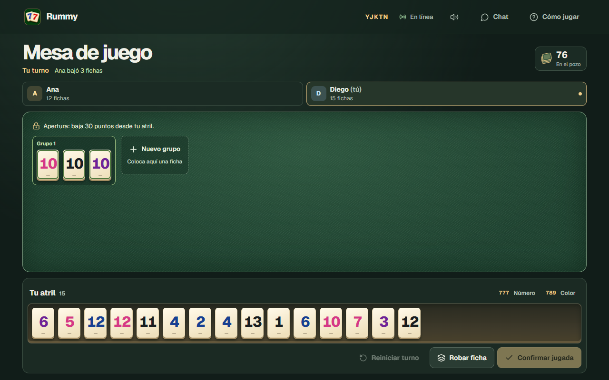
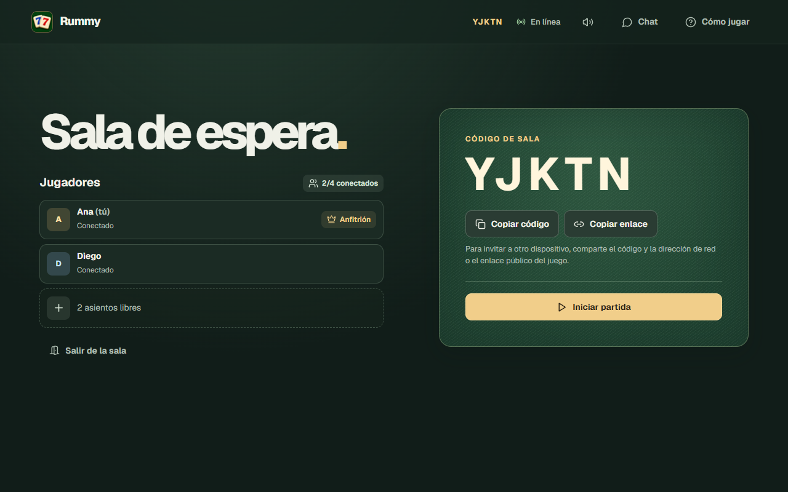
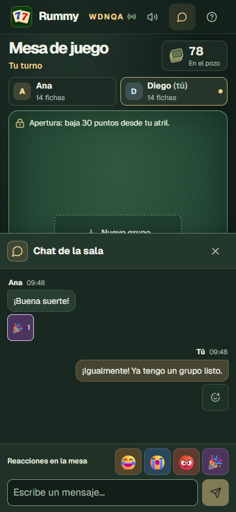

# Rummy

Juego de fichas inspirado en Rummikub para **2 a 4 personas**, en tiempo real y desde el navegador. Crea una sala, comparte el código o enlace y juega desde una computadora o un teléfono. No hace falta crear una cuenta.

[Arranque rápido](#arranque-rápido) · [Cómo jugar](#cómo-jugar) · [Capturas](#capturas) · [Stack y arquitectura](#stack-y-arquitectura) · [Desarrollo](#desarrollo)



## Arranque rápido

**Requisitos:** Git y Docker con el comando `docker compose` disponible. Si ya clonaste el repositorio, omite los dos primeros comandos y ejecuta el tercero desde la raíz del proyecto.

```sh
git clone https://github.com/Dufyzy/Rummy.git
cd Rummy
docker compose up -d --build
```

Abre [http://localhost:8080](http://localhost:8080). Para probar una partida en un solo equipo, crea la sala en tu navegador y únete desde una ventana privada u otro perfil con un segundo nombre.

| Tarea | Comando o dirección |
| --- | --- |
| Ver el estado de los servicios | `docker compose ps` |
| Consultar los logs | `docker compose logs -f client server` |
| Comprobar el backend a través de Nginx | [http://localhost:8080/health](http://localhost:8080/health) → `{"status":"ok"}` |
| Detener la aplicación | `docker compose down` |

Si el puerto 8080 está ocupado, crea un archivo `.env` en la raíz con `RUMMY_PORT=9090`, vuelve a ejecutar `docker compose up -d --build` y abre [http://localhost:9090](http://localhost:9090).

### Jugar en la misma red

1. Conecta los dispositivos a la misma red. En Windows, usa `ipconfig` para localizar la IPv4 del equipo que ejecuta Docker.
2. Abre el juego usando esa IP, por ejemplo `http://192.168.1.25:8080`. Crea la sala **desde esa dirección**, no desde `localhost`, para que el enlace funcione en otros dispositivos.
3. Comparte el enlace de invitación o la dirección del juego y el código de sala.

Si no puedes entrar desde otro dispositivo, comprueba que la red permite la comunicación entre equipos y que el firewall del anfitrión acepta el puerto publicado. En Windows, para una red privada de confianza, puedes permitir el acceso desde la subred local con PowerShell como administrador:

```powershell
New-NetFirewallRule -DisplayName "Rummy LAN TCP 8080" -Direction Inbound -Action Allow -Protocol TCP -LocalPort 8080 -Profile Private -RemoteAddress LocalSubnet
```

### Jugar por internet

El perfil `internet` abre un túnel temporal de Cloudflare hacia Nginx. Desde la raíz del repositorio:

```sh
docker compose --profile internet up -d --build
docker compose --profile internet logs -f tunnel
```

Abre la URL `https://….trycloudflare.com` de los logs y comparte la invitación desde allí. La URL es pública: cualquiera que la conozca puede abrir la aplicación. El enlace de invitación incluye el código necesario para unirse a esa sala. Al reiniciar el túnel se genera otra URL.

- Cerrar solo el acceso público: `docker compose --profile internet stop tunnel`.
- Detener todo, incluido el túnel: `docker compose --profile internet down`.

> **Estado en memoria:** no hay base de datos. Si reinicias el servidor, se pierden las salas, las partidas y el chat. Si solo recargas la misma pestaña, el juego puede recuperar tu asiento con `sessionStorage` mientras la sala y el asiento sigan activos.

## Cómo jugar

1. **Crea la sala.** Escribe tu nombre, pulsa **Crear sala** y comparte el enlace o el código de cinco letras. El anfitrión pulsa **Iniciar partida** cuando haya al menos dos personas conectadas.
2. **Recibe tus fichas.** Cada jugador recibe 14 fichas en su atril. El juego utiliza 106 fichas: dos copias de los números del 1 al 13 en cuatro colores (rosa, azul, negro y morado), más dos comodines. Lo que sobra forma el pozo.
3. **Abre con 30 puntos.** En tu primera jugada, baja uno o varios grupos válidos que sumen al menos 30 puntos, usando solo fichas de tu atril. Cada ficha vale su número; el comodín vale el número que representa en el grupo.
4. **Juega sobre la mesa.** A partir de tu siguiente turno puedes ampliar o reorganizar los grupos existentes. Para confirmar, todos los grupos de la mesa deben quedar válidos y tienes que bajar al menos una ficha de tu atril.
5. **Vacía tu atril para ganar.** Si el pozo se acaba y todos pasan consecutivamente, gana quien tenga menos puntos en el atril. Cada comodín que quede en el atril vale 30 puntos. Si hay empate en el mínimo, la victoria se comparte.

### Grupos válidos

| Grupo | Regla | Ejemplo |
| --- | --- | --- |
| **Trío o cuarteto** | Tres o cuatro fichas del mismo número, todas de distinto color. | **10 rosa · 10 negro · 10 morado** (30 puntos) |
| **Escalera** | Tres o más números consecutivos del mismo color, en orden ascendente. El 1 va antes del 2, no después del 13. | **9 azul · 10 azul · 11 azul** (30 puntos) |

Después de abrir, puedes recuperar un **comodín** de la mesa colocando sobre él la ficha exacta que representa (número y color). Debes reutilizarlo en otro grupo válido durante el mismo turno.

### Controles del turno

- **Mover fichas:** selecciona una y pulsa su destino, o arrástrala. En móvil, mantén una pulsación breve para arrastrar; desliza sin esperar para recorrer el atril.
- **Bajar un grupo de una vez:** selecciona una ficha de un grupo válido en tu atril y pulsa **Bajar N juntas**, o mantén pulsada la ficha un poco más antes de arrastrar. Ordenar por **Número** prioriza tríos y cuartetos; por **Color**, escaleras.
- **Confirmar jugada** envía el borrador para validarlo y cede el turno si se acepta. **Reiniciar turno** restaura la mesa y el orden del atril al inicio del turno.
- **Robar ficha** descarta el borrador, añade una ficha del pozo y cede el turno. Si el pozo está vacío, el botón cambia a **Pasar**.

### Chat y sonido

Abre **Chat** en la sala de espera o en la mesa. El botón de reacción aparece en el último mensaje; para reaccionar a uno anterior, mantén pulsada su burbuja. Con teclado, enfoca la burbuja y pulsa **Enter** o **Espacio**. También puedes lanzar una reacción rápida que aparece junto a tu nombre.

Con el chat cerrado, los mensajes nuevos se muestran brevemente junto al remitente y el botón indica cuántos quedan sin leer. La sala conserva los últimos 80 mensajes. Usa el icono de altavoz para activar o silenciar los avisos de chat y de turno.

## Capturas

| Sala de espera en escritorio | Chat durante una partida en móvil |
| :---: | :---: |
|  |  |

## Stack y arquitectura

| Capa | Tecnologías y función |
| --- | --- |
| **Interfaz** | React 19 y TypeScript; Vite para desarrollo y compilación, Tailwind CSS y CSS para la interfaz adaptable, dnd-kit para arrastrar fichas y Framer Motion para animaciones. |
| **Servidor** | Node.js, Express 5 y TypeScript. Express expone `/health`; el servidor administra las salas, el reparto, los turnos y el resultado. |
| **Comunicación** | Socket.IO 4 sincroniza la mesa, los jugadores, las jugadas y el chat. Cada jugador recibe solo su propio atril. |
| **Infraestructura** | Docker Compose levanta el cliente y el servidor. Nginx sirve el cliente compilado y reenvía `/socket.io/` y `/health`. Cloudflared es opcional. |
| **Pruebas** | El servidor usa `node:test` para verificar las reglas, incluyendo apertura, comodines, robo, pases y empates. |

El cliente permite mover las fichas en un **borrador local** antes de confirmar. Al enviar la jugada, el servidor reproduce los movimientos, comprueba las reglas y publica el nuevo estado solo si todo es válido. Las reglas de grupos y las operaciones del borrador se comparten entre ambos.

```text
client/                Interfaz, tablero, atril, animaciones y chat
server/index.ts        Salas, reconexión y eventos de Socket.IO
server/gameLogic.ts    Reparto, validación de turnos y fin de partida
server/draft.ts        Aplicación de movimientos al borrador
server/melds.ts        Validación de tríos, cuartetos y escaleras
server/protocol.ts     Tipos y eventos compartidos
client/nginx.conf      Configuración del proxy en Docker
docker-compose.yml     Servicios y perfil de acceso por internet
```

## Desarrollo

### Ejecutar sin Docker

Necesitas Node.js y npm. El flujo local se probó con Node.js 22. Desde la raíz del repositorio:

```sh
npm --prefix server ci
npm --prefix client ci
```

Luego ejecuta cada comando en una terminal separada:

```sh
npm --prefix server run dev
```

```sh
npm --prefix client run dev
```

Abre [http://localhost:5173](http://localhost:5173). Vite reenvía `/socket.io/` al backend en el puerto `3000`; en modo desarrollo, el endpoint de salud está directamente en [http://localhost:3000/health](http://localhost:3000/health).

### Pruebas y compilación

```sh
npm --prefix server test      # Compila el servidor y ejecuta sus pruebas
npm --prefix client run build # Comprueba tipos y genera client/dist/
```

### Evolución del proyecto

- **Primera versión:** salas multijugador, reglas y turnos validados por el servidor, soporte móvil y arranque con Docker.
- **Experiencia de juego:** reparto animado, movimiento de grupos completos, nueva paleta de fichas y resaltado de jugadas confirmadas.
- **Interacción entre jugadores:** chat de sala, reacciones a mensajes y en la mesa, avisos visuales y sonidos para mensajes y cambios de turno.
